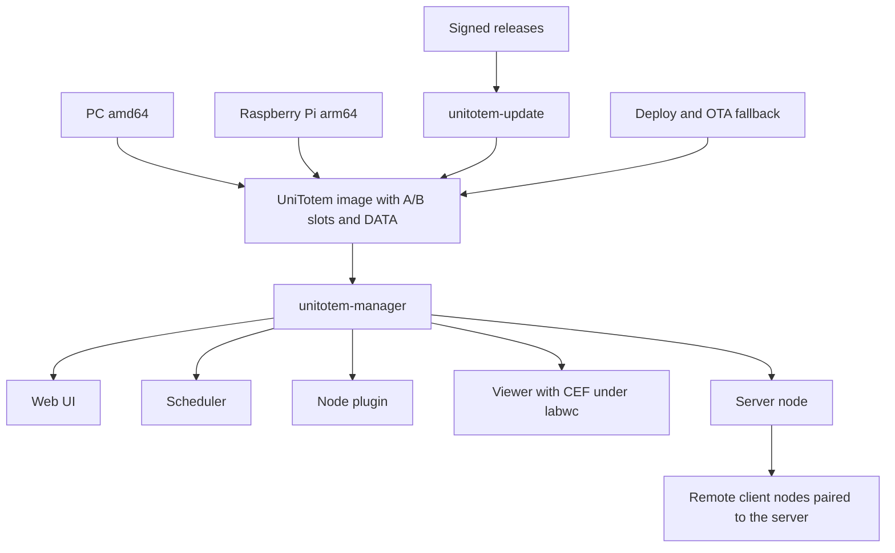

# UniTotem documentation

Component documentation of the UniTotem repository. System docs describe the image, boot, update and deploy tooling; manager docs describe `unitotem-manager`. Paths in `system/` docs are relative to the repository root, in `manager/` docs to `unitotem-manager/`.

## System

- [build.md](system/build.md): image build pipeline for amd64 and arm64.
- [package-lock.md](system/package-lock.md): pinned package sets used by the build.
- [installer-iso.md](system/installer-iso.md): amd64 installer ISO (build, flow, tests).
- [boot.md](system/boot.md): bootloaders, A/B slot choice, trial boot, splash, Secure Boot chain.
- [storage-and-persistence.md](system/storage-and-persistence.md): partitions, read-only root, DATA overlays.
- [image-runtime.md](system/image-runtime.md): services, timers, network, Wayland session, maintenance mode on a deployed image.
- [ab-updates.md](system/ab-updates.md): whole-image A/B updates, health-gated confirm, rollback, automatic policy.
- [release.md](system/release.md): release tooling and signing keys.
- [deploy-and-recovery.md](system/deploy-and-recovery.md): network install, OTA fallback and recovery of a target.
- [windows-install-research.md](system/windows-install-research.md): research on installing from Windows.
- [legacy-pi-gen.md](system/legacy-pi-gen.md): the pi-gen based tree kept for reference.
- [testing.md](system/testing.md): system tests and harnesses.

## Manager

- [overview.md](manager/overview.md): functional specification.
- [backend.md](manager/backend.md): web server, websocket API, sessions, uploads, backup, notifications, plugin loader.
- [scheduler.md](manager/scheduler.md): playlists, assets, uploads, assignment to windows and panes.
- [layout-and-ticker.md](manager/layout-and-ticker.md): window layouts and the RSS ticker.
- [viewer.md](manager/viewer.md): fullscreen CEF windows, Qt splash, compositor units, on-screen keyboard.
- [cef.md](manager/cef.md): CEF runtime, Wayland Views API, CEF and wheel builds, codecs, hardware decode.
  - [cef/wayland-design.md](manager/cef/wayland-design.md), [cef/pr-cef.md](manager/cef/pr-cef.md), [cef/pr-cefpython.md](manager/cef/pr-cefpython.md): Wayland patch design and upstream PR texts.
  - [cef/lean-build.md](manager/cef/lean-build.md): reduced CEF build study.
- [webui.md](manager/webui.md): Vue web UI, websocket client, pages, API groups.
- [security.md](manager/security.md): accounts, capabilities, sessions, tokens.
- [remote.md](manager/remote.md): pairing and mutual-TLS link between server and client nodes.
- [node-system.md](manager/node-system.md): node plugin: network, audio, power, timers, updates, terminal, screen view.
- [screens-and-touch.md](manager/screens-and-touch.md): screen power, input and volume, touch mapping and calibration.
- [packaging.md](manager/packaging.md): Debian packages, build scripts, apt repository.
- [testing.md](manager/testing.md): unit tests and browser and API tools.
- [testing-vm.md](manager/testing-vm.md): VM and board test lab.

## Architecture

- Devices run the UniTotem image; the manager runs on top of it.
- Signed releases reach the device through `unitotem-update`; deploy and the OTA fallback cover first install and recovery.
- A server node drives paired client nodes over a certificate-pinned link.
